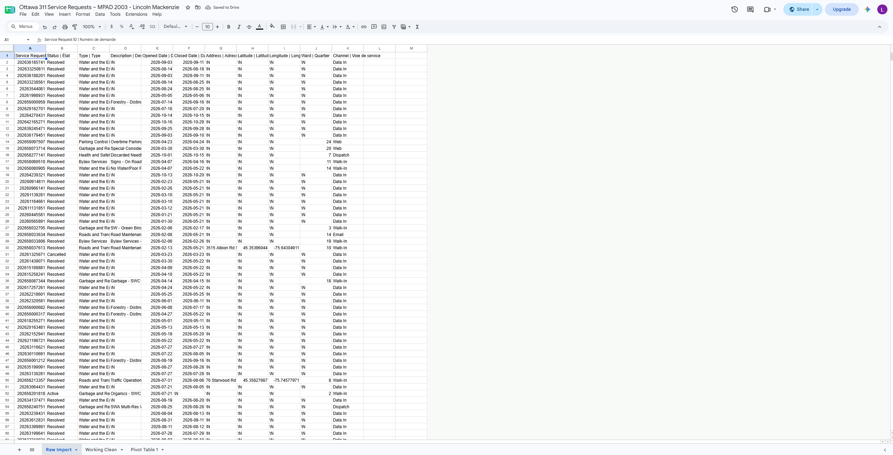
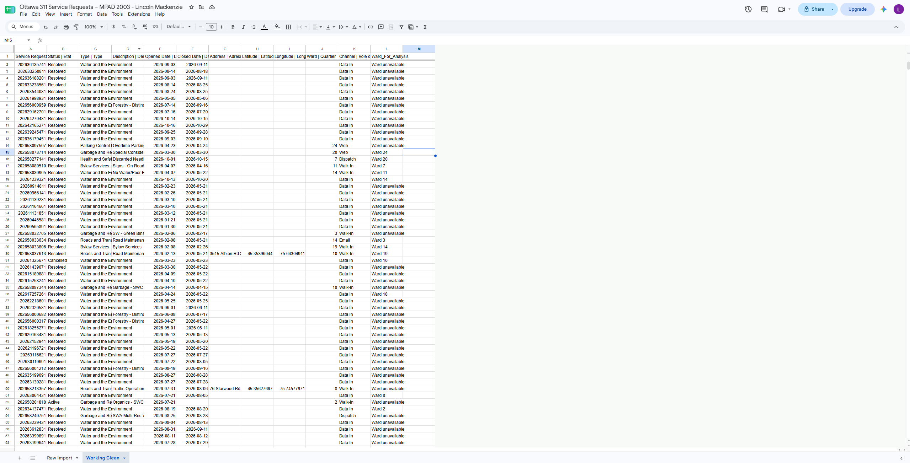
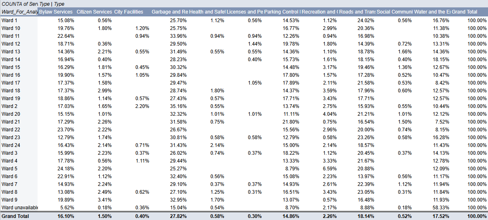

**November 1 2026** 
**MPAD2003 - Data Storytelling** 
**Lincoln Mackenzie** 
**Presented to Jean-Sébastien Marier** 

# Deliverable 2: Exploratory Data Analysis (EDA)

## Foreword
A pothole, Garbage still on your driveway, fallen tree, these are things that can promp Ottawa residents to contact 311. Individual reports may seem normal but when grouped together they can show different patterns that reval how resident use these municipal services. Building on assignemnt 1 (my proposal) i want to compare the mix of service types across ottawa wards, not just by ranking wards by number of call but seeing why residents are calling in each of these wards

## 1. Getting Data
I selected the city of ottwawas current year service requests data set which record all calls for municipoal services that require action from someone in the city.   The city gets these calls through its 311 contact number, service centres, email and the online self portal (City Of Ottawa, 2026). My question is: Do certain kind of 311 requests accpimt for unusually big shares of 311 activity in certain wards. This is a question about reported service needs, not a direct scale looking at the quality of each neibourhood.

To import the data, i downlaoded the csv  from the data set online. In google sheets i made a blank spreadsheet. Then i found the data set and in google sheets went file --> import --> upload, once imported into a new sheet and checked that the first row contained seperate field names. I retained a untoched tab called Raw_Import and made a copy called Working_clean before i edited anything 

Public Spreadsheet: https://docs.google.com/spreadsheets/d/1uR1RahZ7FCiUXT10IK6zn1jHEC5j_rE8KFFhthIxDsU/edit?usp=sharing

The imported sheet contains 5001 datta rows and 11 colums as of october 28th 2026, there are a ton of mistake throughout the data with missing values, wards, addresses, times. But we cleaned all of this up in the google sheet

The ward field is a nominial caregorical variable, a ward number is an identifier not a quality that has any meaning worth averageing. Type is also a nominal value by serpeating service categories without ranking them. Opened Date is a date/time variable that allows daily or monthly comparisions of the data. And a fourth useful field would be the service request ID, this connectes a number to a recortd and can help check for duplicates. Stats Canada (2021) emphasizes identifying variable types

*Figure 1: Ottawa 311 dataset before cleaning, showing the original column headings and service requests.*

 
## 2. Understanding Data

### 2.1. VIMO Analysis
Before cleaning and analyzing the data set i got from 311 ottawa, i needed to look ath the quality of the information that i was given. Is it comeplete? Are there errors? Is there anything i can manually fix?
I Used the VIMO method which stands for, valid, invalid, missing, and outlier values. This assisted me in understanding how reliable the data was and what problem could affect my analysis of the data.

Valid Values: A ton of the records seemed to have contained valid information that will be usefull and helpful. For example, the type column had categories such as "Water and Enviroment" while the status column contained data such as "resolved". These are useful as it shows what has been requested in ottawa, what is still being worked on and what the city has already completed. 

Invalid Values: I needed to check for info that might have been entred incorrect. This could include things such as inconsistant categories, incorrect dates and any requests that got submitted twice (either same ID or same address)

Missing Values: One of the largest issues that i ran into was missing info. Some records contained \N instead of giving an actual value. Example: Certain requests had no description, address or in some cases even a ward. This is a huge deal beacuse missing ward information prevents not only me  from identifying where  theos requests came from but it will also make it hard for the city of ottawa to fix these problems if they dont even know where the problem is. 

Outliers: I Also wanted to look into whether certain wards reported weirdly high numbers of certain requests. Although an unusually high number dosent just mean that there is an error. It could mean that there is sensitive or private information, but it could also be a real pattern worth looking into. I will look furtur into this using my pivot table

### 2.2. Cleaning Data
Before diving deep into the data i first wanted to clean the data up, this helps make the data easier to understand and read. I did this on google sheets using a seperate tab from the orinigal data called "Working Clean" while keeping the orinigal data in "Raw Import" 

TThe first method i used was the find and replace method. Some record contained a \N, which shows that ottawa 311 had missing information there. I selected Edit, then went to find and replace. I searched for \N and replaced it with blank cells. This made missing values wayyyyyyyyy easier to find, however, it did not bring back the information that was originally missing 

My second method was the Trim Whitespace Method. I sleected the data set and used Data > Data Cleanup > Trim Whitespace. This looked around for unneeded black spaced around text values. Extra spaces can make google sheets treat two values who technically fall under the same category show up as different values. This is not good. 

My third method was checking for any duplicate records. I selected all the data with CTRL + A and used data > data cleanup > remove duplicates. Though this eneded up not being that necisarry as it found 0 duplicates but with large data sets its always good to try just incase. Better then finding duplicate data. 

I also used freeze under the view menu to keep the first row clearly visable while scrolling thorugh the spreadsheet. This made it way easier to find the columns needed for cleaning. 

I created a new column called ward_For_Analysis to serpeate requests assigned to a ottawa ward from missing ward information requests. Instead of deleting the records i renamed them to "Ward Unavailable" 

The formula i used for this was =IF(J2="", "Ward Unavailable", "Ward "&J2)

this kept all records while making ward information easier to read and understand quickly 

*Figure 2: Ottawa 311 dataset after cleaning in Google Sheets.*
### 2.3. Analyzing Data
After cleaning up my 311 dataset, i wanted to see if different wards had different types of service requests. To do this i made a pivot table in sheets using "Ward_For_Analysis" as my rows, yupe as my colums and counta of service request ID as the values, i then looked at the percentages of each request type and how they differed between each ward. 

Of the 5000 records in my sample, 551 has mnissing information leaving 4449 records unused (that could have been used)

Some of the cool patters i saw while doing there were, ward 24, garbage and recycling made up for around 42.9% of request calls. In ward 5, roads and transpo where 40.7%, while bylaw services made up of 31.3% of requests in ward 12

I chose these variables beacuse i wanted to compare the different problems being reported rather than simply which ward contacted the city most often

I also made 100% bar chart (stacked) to see the differences in proportion of diffrent categories, which was really cool.  This made it easier to see how the mix of reports changes between wards.

These findings show that different areas of ottawa may have different concerns from its residents. The results are based on a sample however, and with more time and investigating we would be able to draw a much more clear conclusion. 

Figure 3: Pivot table showing the percentage of service request types across selected Ottawa wards.

Figure 4: Exploratory chart comparing service request categories across selected Ottawa wards.
## 3. Delivering Data
After taking a peek at the 311 request data, i think that there is a ton of portential to make a story about how residents expereience different problems depending on which ward they are currently staying in. The end goal is to get an understanding as to why ceretain types of these requstes are showing up more in certain wards over others. 

The data shows how often these residents contact the 311 number about different municiple services, but it dose not explain  why these thinks are becoming an issue in the first place. Just because one ward is seeing more requests dosent mean directly that its a worse place to live. It could just mean that the residents in that area are more familliar with the 311 number than other wards. 

To build this further i would compare this data set of 311 calls with previous years. I would also look at the differences in things like population, buldings, and whether these certain wards have old roads or housing. 

I would want to interview residents from the wards that i look at as well as anyone from the city who has a part in these 311 calls. There perspective could shine some important light on my topic. 

I also found previous reporting by Capitol Current that could help give some more context. Young et al. (2024) investigated the potholes problem in ottawa using the 311 data, while lao et al (2024) took a look at the complaints areound university neibourhoods starting in september. 

Using these insperations my story would build on this reporting by looking at many different categories of requests reather than focusing on one issue. 

## 4. Refrences

City of Ottawa. (2026). Current year service requests. Open Ottawa. https://data.urbandatacentre.ca/en/catalogue/open-ottawa-9de005-current-year-service-requests

Lao, L., Sacheski-Tries, N., & Swinarchin, C. (2024, December 1). Noise complaints climb in September as academic year begins, data shows. Capital Current. https://capitalcurrent.ca/noise-complaints-climb-in-september-as-academic-year-begins/

OpenAI. (2026). ChatGPT [Large language model]. https://chatgpt.com/

Statistics Canada. (2021, September 2). Data exploration. Statistics: Power from Data! https://www150.statcan.gc.ca/n1/edu/power-pouvoir/ch8/5214810-eng.htm

Young, A., Noble, A., Brombach, J., & Carrillo Brito, S. (2024, December 3). Ottawa's pothole problem: The city's need for road renewal. Capital Current. https://capitalcurrent.ca/ottawas-pothole-problem-the-citys-need-for-road-renewal/